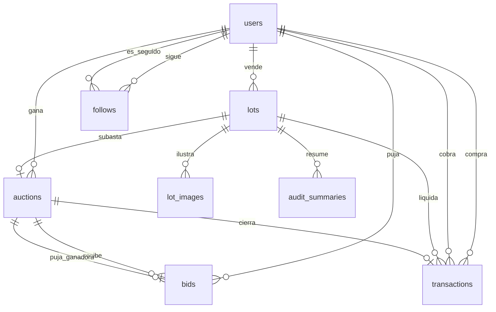
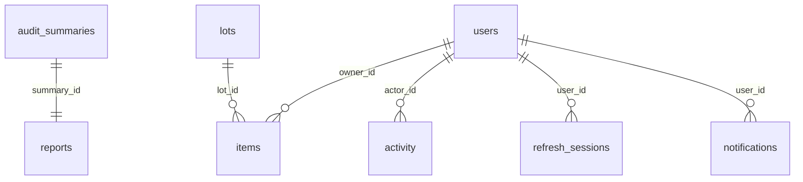

# Modelo de datos

Todo vive en PostgreSQL, un esquema por servicio. Lo que debe ser consistente bajo una transacción (cuentas, lotes, pujas, liquidación) va en columnas con restricciones. Lo anidado (informes de auditoría, payload de los avisos) va en JSONB dentro del esquema de su dueño. Hasta `v0.8.0` esos documentos vivían en MongoDB.

El visitante no tiene fila en `users`. Los roles persistidos son `USER`, `SELLER` y `ADMIN`.

## Relacional

| Tabla | Papel |
|---|---|
| `users` | Cuenta, rol y visibilidad del perfil. El correo se guarda en minúsculas. |
| `lots` | Obra. Tras la auditoría aprobada queda `PUBLICADA`, pasa a `EN_SUBASTA` y termina en `VENDIDA` o vuelve a `PUBLICADA`. El detalle está en `subastas-artacoins.md`. |
| `lot_images` | Clave del objeto en Cloud Storage, orden y hash perceptual. El binario no está aquí. |
| `auctions` | Una subasta por lote. Si cierra sin venta, la misma fila se reprograma. `ends_at` es el cierre vigente. |
| `bids` | Puja con `idempotency_key` único. `winning_bid_id` en la subasta apunta a la puja ganadora. |
| `transactions` | Como máximo una liquidación por subasta. Comprador y vendedor son distintos. |
| `audit_summaries` | Score, rango de precio, veredicto y quién decidió (`RULES`, `AI` o `FALLBACK`). |
| `follows` | Arista dirigida. Una cuenta no puede seguirse a sí misma. |

Transiciones de lote que el servicio de catálogo debe respetar:

- `BORRADOR` → `PENDIENTE_AUDITORIA`
- `PENDIENTE_AUDITORIA` → `PUBLICADA` o `REVISION_MANUAL`
- `REVISION_MANUAL` → `PUBLICADA` o `BORRADOR`
- `PUBLICADA` → `EN_SUBASTA`
- `EN_SUBASTA` → `VENDIDA` o `PUBLICADA`

`APROBADO` y `CERRADO` siguen aceptados para filas anteriores. `current_price` no baja y `ends_at` no se adelanta, salvo el retiro de la puja ganadora y la reprogramación, que lo hacen dentro de la transacción. El contrato de artacoins, retenciones y calendario está en `subastas-artacoins.md`.

## Documentos en JSONB (desde 0022)

Solo `audit.reports` → `audit.audit_summaries` es una llave foránea, porque está dentro del mismo esquema. Las demás aristas cruzan servicios: son UUID sin llave.

| Tabla | Papel |
|---|---|
| `audit.reports` | Informe completo, 1 a 1 con su resumen: expediente de evidencias y evaluación en JSONB. Se guarda en la misma transacción que el resumen. |
| `gallery.items` | Obra propia, ganada o gratuita. La visibilidad es `PUBLIC` o `PRIVATE` por pieza. El id es determinista (`PROPIA:<obra>:<dueña>`). |
| `gallery.activity` | Verbos `PUBLISH`, `BID`, `WIN`, `FOLLOW`, `AUDIT`. El feed lee lo público con un índice parcial `WHERE visibility = 'PUBLIC'`. |
| `identity.refresh_sessions` | Hash SHA-256 del refresh, su familia y su vencimiento. identity borra las vencidas con un barrido, lo que en Mongo hacía un índice TTL. |
| `notification.notifications` | Aviso con su payload en JSONB. El id es `<evento>:<destinatario>`, así un evento repetido no duplica el aviso. |

Una obra con `gallery.items.visibility = PRIVATE` o `lots.visibility = PRIVATE` no aparece en las lecturas públicas.
